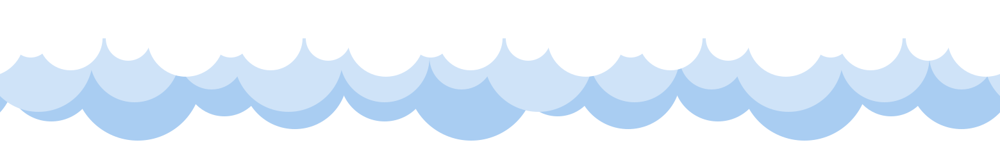
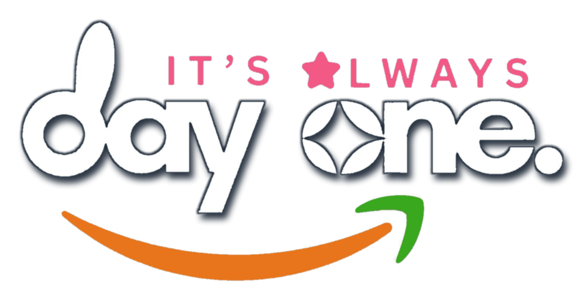

<div align="center">

  <!-- Cloud Border / Scallop Header -->
  

  <br />

  <!-- Logo & Mascot Hero Header -->
  <a href="#readme">
    
  </a>

  <br /><br />

  

  <br />

  # 🌸 Sugar, Spice & Everything Git 🌸
  ### ☁️ *My First Portfolio Starter Template* ☁️

  <p align="center">
    <b>A bubbly, playful, beginner-friendly portfolio website template inspired by Powerpuff Girls vibes & Day One aesthetics!</b>
    <br />
    <i>Crafted with soft cloud blues, sweet berry pinks, and modular React components.</i>
  </p>

  <!-- Badges -->
  <p align="center">
    <a href="https://nextjs.org/"></a>
    <a href="https://react.dev/"></a>
    <a href="https://tailwindcss.com/"></a>
    <a href="https://vercel.com/"></a>
    <a href="LICENSE"></a>
  </p>

  <!-- Navigation Bar -->
  <p align="center">
    <a href="#-about-this-repository">🌸 About</a> •
    <a href="#-learning-goals">🎯 Goals</a> •
    <a href="#-prerequisites">📋 Prerequisites</a> •
    <a href="#-quick-start">🚀 Quick Start</a> •
    <a href="#-component-guide--folder-structure">📂 Components</a> •
    <a href="#-deploy-with-vercel">☁️ Deploy</a> •
    <a href="#-submission-instructions">📬 Submission</a> •
    <a href="#-help-and-contact">💖 Help</a>
  </p>

  

</div>

<br />

## 🌸 About This Repository

> **Welcome, builders & creators!** 🎀  
> This is a starter template for building your very first personal portfolio website with **Next.js**, **React**, and **Tailwind CSS**. It is specially created for **[target audience, e.g. first-year students]** attending **[event name]** hosted by **[organization name]**.

You **don't** need any prior web development experience! The project is split into clean, single-purpose components under `app/components/`. Every spot you need to customize is clearly tagged with a **`✏️ EDIT THIS`** comment so you can personalize your portfolio with zero guesswork.

<div align="center">
  <table>
    <tr>
      <td align="center"><b>🎨 Powerpuff Aesthetic</b><br/>Playful, retro-modern visuals with custom pixel cursors, cloud scallops, and pastel highlights.</td>
      <td align="center"><b>🧩 Modular Components</b><br/>Separation of concerns: every page section lives in its own dedicated, easy-to-edit file.</td>
      <td align="center"><b>⚡ Ready for Deploy</b><br/>Pre-configured for instant zero-configuration publishing on Vercel with automatic CI/CD.</td>
    </tr>
  </table>
</div>

---

## 🎯 Learning Goals

By the end of this workshop, you will be able to:

<table>
  <tr>
    <td width="50" align="center">🌸</td>
    <td><b>Build a Modern Multi-Section Website:</b> Understand the basics of React components, JSX syntax, and responsive layouts.</td>
  </tr>
  <tr>
    <td width="50" align="center">💙</td>
    <td><b>Version Control with Git & GitHub:</b> Clone, edit, commit, and push your changes to your own public GitHub repository.</td>
  </tr>
  <tr>
    <td width="50" align="center">💚</td>
    <td><b>Deploy to the World with Vercel:</b> Connect your repository to Vercel and publish a live <code>.vercel.app</code> website.</td>
  </tr>
  <tr>
    <td width="50" align="center">⭐</td>
    <td><b>[Learning goal 4]:</b> Showcase your own personal projects, skills, education, and social links to recruiters and peers.</td>
  </tr>
</table>

---

## 📋 Prerequisites

Before the event begins, please make sure you have the following ready:

- [ ] 🐙 **[GitHub Account](https://github.com/)** — to save, manage, and share your code
- [ ] ▲ **[Vercel Account](https://vercel.com/)** — sign up with your GitHub account for 1-click deployments
- [ ] 🌿 **[Git Installed](https://git-scm.com/)** — command-line version control tool
- [ ] 🟢 **[Node.js (v20 or newer)](https://nodejs.org/)** — the JavaScript runtime that powers the dev server
- [ ] 💻 **[VS Code](https://code.visualstudio.com/)** (or your favorite code editor)

---

## 🚀 Quick Start

Get your portfolio running locally on your computer in just a few minutes!

### 1️⃣ Use This Template
Click the green **"Use this template"** button at the top of this repository on GitHub, then select **"Create a new repository"**. Name it something cute like `my-portfolio`!

### 2️⃣ Clone Your New Repository
```bash
git clone https://github.com/[your-username]/[your-repo-name].git
cd [your-repo-name]
```

### 3️⃣ Install Dependencies
```bash
npm install
```

### 4️⃣ Start the Development Server
```bash
npm run dev
```

### 5️⃣ Open Your Browser
Navigate to **[http://localhost:3000](http://localhost:3000)**.  
Open the project in VS Code, edit any component file, save it, and watch your changes update instantly with Fast Refresh! ✨

---

## 📂 Component Guide & Folder Structure

All section components live in `app/components/` with camelCase filenames. Look for the **`✏️ EDIT THIS`** comments inside each file!

```
[repo-name]/
├── app/
│   ├── layout.jsx                # Global HTML shell & font definitions
│   ├── page.jsx                  # Main page composer (imports sections & bunny cursor)
│   ├── globals.css               # Global theme styles & animations
│   └── components/
│       ├── header.jsx            # ✏️ Top navigation bar, links, and logo
│       ├── intro.jsx             # ✏️ Hero card, greeting, name, role, bio, CTA & mascot
│       ├── aboutMe.jsx           # ✏️ Personal background & highlight cards
│       ├── skills.jsx            # ✏️ Categorized skill badges & tool icons
│       ├── projects.jsx          # ✏️ Project showcase cards with links & tags
│       ├── educationExperience.jsx # ✏️ Education & experience timeline entries
│       ├── contact.jsx           # ✏️ Contact form, email, and social profiles
│       └── footer.jsx            # ✏️ Cloud footer, social links, and copyright
├── public/
│   ├── assets/
│   │   ├── fonts/                # Fredoka & Nunito custom fonts
│   │   └── images/               # Symlink to images directory
│   ├── images/                   # Bunny mascot, logo, banners, and project photos
│   └── js/
│       └── script.js             # Optional vanilla JavaScript scripts
├── package.json
└── README.md
```

### ✏️ Where Do I Edit My Info?

| Section Component | File Path | What You Can Customize |
|:---|:---|:---|
| **Header** | [`app/components/header.jsx`](app/components/header.jsx) | Navigation links, brand logo image |
| **Intro / Hero** | [`app/components/intro.jsx`](app/components/intro.jsx) | Name, role badge, bio paragraph, quick tags, mascot image |
| **About Me** | [`app/components/aboutMe.jsx`](app/components/aboutMe.jsx) | Personal bio, highlight cards (years of experience, interests) |
| **Skills** | [`app/components/skills.jsx`](app/components/skills.jsx) | Technical skills, design tools, frameworks, proficiency categories |
| **Projects** | [`app/components/projects.jsx`](app/components/projects.jsx) | Project titles, descriptions, live demo links, GitHub links, tags |
| **Education & Exp** | [`app/components/educationExperience.jsx`](app/components/educationExperience.jsx) | Degree, school, past roles, dates, milestones |
| **Contact** | [`app/components/contact.jsx`](app/components/contact.jsx) | Email address, LinkedIn, GitHub, form action |
| **Footer** | [`app/components/footer.jsx`](app/components/footer.jsx) | Social links array, copyright notice, footer mascot |

---

## 📖 Full Participant Guide

Need detailed, step-by-step instructions for the workshop?  
👉 **[Read the Full Participant Guide]([link-to-participant-guide])**

---

## ☁️ Deploy with Vercel

Share your portfolio with the world in less than 2 minutes!

<div align="center">
  <a href="https://vercel.com/new">
    
  </a>
</div>

<br />

1. Push all your saved changes to your GitHub repository:
   ```bash
   git add .
   git commit -m "Customize my portfolio!"
   git push origin main
   ```
2. Head over to **[vercel.com/new](https://vercel.com/new)** and log in with GitHub.
3. Find your portfolio repository and click **Import**.
4. Keep all default build settings (Next.js is automatically detected).
5. Click **Deploy**! 🚀
6. In about a minute, your website will be live at `https://[your-project-name].vercel.app`!

---

## 📬 Submission Instructions

Once your website is deployed and shining bright:

1. ✅ Verify your live Vercel link opens properly and all sections look great.
2. 📋 Copy your live deployment URL (e.g., `https://my-portfolio.vercel.app`).
3. 📝 Submit your link through the official event form: **[Submit Your Portfolio Form]([form-link])**

> [!IMPORTANT]
> **Submission Deadline:** `[submission-deadline]`

---

## 💖 Help and Contact

Got stuck or have questions? Don't worry, the facilitators are here to help!

<div align="center">
  <table>
    <tr>
      <td align="center" width="200">
        <br />
        <b>Facilitator</b><br />
        <a href="[email-or-social-link]">[facilitator-name]</a>
      </td>
      <td align="center" width="200">
        🌟<br />
        <b>Event Page</b><br />
        <a href="[event-page-link]">[event-page-link]</a>
      </td>
      <td align="center" width="200">
        💬<br />
        <b>Community Chat</b><br />
        <a href="[group-chat-or-discord-link]">[group-chat-or-discord-link]</a>
      </td>
    </tr>
  </table>
</div>

### 📚 Helpful Documentation
- [Next.js Documentation](https://nextjs.org/docs)
- [Tailwind CSS Documentation](https://tailwindcss.com/docs)
- [React Documentation](https://react.dev/)
- [Vercel Deployment Guide](https://vercel.com/docs)

---

## 📜 License

This project is open source and available under the [MIT License](LICENSE).

<div align="center">
  <br />
  
  <br />
  <p align="center">
    Made with 💖, ☁️, and lots of code for <b>[event name]</b>.<br />
    <i>"It's always day one." ✨</i>
  </p>
</div>